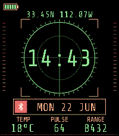
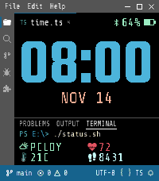
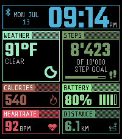
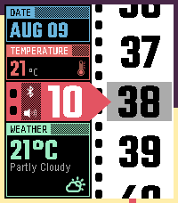
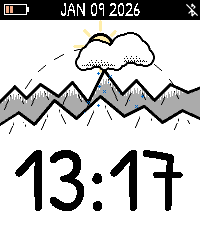

# Pebble Watchfaces

These are my Pebble watchfaces, all built on my shared [framework](https://github.com/AKlitbo/pebble-app-framework). Each face's own page covers its settings, where its data comes from, and its previews.

## Watchfaces

| Preview | Watchface | What It Shows | Watches |
| :--: | :-- | :-- | :-- |
|  | [Radar Array](watchfaces/radar-array/) | A radar scope with the time, the date, your coordinates, the temperature, your heart rate, and your steps. | Pebble Time 2 |
|  | [IDE VSCode](watchfaces/ide-vscode/) | A code editor with the time, the date, the weather, your heart rate, your steps, and the battery. | Pebble Time 2 |
|  | [Gridlock](watchfaces/mosaic/gridlock/) | A grid you fill with panels for the time, the weather and forecast, your health, your calendar, and stock quotes. | Pebble Time 2 |
|  | [Sidereel](watchfaces/mosaic/sidereel/) | A reel of minutes beside an hour pointer, with panels for the date, the weather, and your health. | Pebble Time 2 |
|  | [Sketchbook Horizon](watchfaces/sketchbook-horizon/) | A hand-drawn landscape whose sky follows the sun and the weather, with the time, the date, and your stats. | Pebble Time 2 and Pebble Round 2 |

Gridlock and Sidereel are the Mosaic faces, which share their panels and much of their settings page.

### Separate Repository

LCARS Stardate lives in [its own repository](https://github.com/AKlitbo/pebble-watchface-lcars), since its artwork follows the *Star Trek* fan project guidelines and carries a noncommercial licence. Its `.pbw` is on that repository's releases page.

| Preview | Watchface | What It Shows | Watches |
| :--: | :-- | :-- | :-- |
|  | [LCARS Stardate](https://github.com/AKlitbo/pebble-watchface-lcars) | An LCARS frame with the time, the date, and four panels of readouts you pick. | Pebble Time 2 |

## Install

Grab a face's `.pbw` from [Releases](https://github.com/AKlitbo/pebble-watchfaces/releases) and open it with the Pebble app on your phone.

Each face has its own version, and each release's notes are that version's changelog entry. A file named for one watch, such as `radar-array-emery-1.6.3.pbw`, is for the Time 2 (Emery) only. A file named by version alone, such as `sketchbook-horizon-1.1.0.pbw`, holds a build for each watch the face supports. Gridlock comes as a watchface and a watchapp, and [its page](watchfaces/mosaic/gridlock/#installation) says which is which.

## Bugs and Requests

Please open bugs and requests for any of my faces, LCARS Stardate included, in [Issues](https://github.com/AKlitbo/pebble-watchfaces/issues).

## Building Them Yourself

You need [`paf`](https://github.com/AKlitbo/pebble-app-framework-cli#install) and the Pebble SDK. I run everything from WSL, since the build needs the SDK and `paf sync` installs `node_modules` for whichever system runs it. `paf doctor` tells you if anything is missing.

```sh
paf sync                      # fills every unit's paf/ from the framework tag in its paf.config.json and installs node_modules
paf build <face> [--clean]    # the .pbw, into the unit's targets/<target>/build/, from WSL with the Pebble SDK installed
paf build all                 # every face
```

The generators and tools take a face's name and run in the unit that holds it:

```sh
paf gen <face> all             # every generator the face has inputs for
paf gen <face> <kind>          # one of clay, icons, thumbnails, background, or Mosaic's vibrant
paf tool <face> clay-preview   # the settings page in a browser, from the dev plugin
paf tool <face> tap-walk       # screenshot every state of the dev walk, from WSL
paf tool <face> thumbnails     # reshoot the layout builder's panel pictures on the emulator, from WSL
```

CI runs these checks in every unit, each against its own framework:

```sh
paf test
paf lint [--fix]       # the house style, from the code-style plugin
paf format --check     # the CSS, JSON, and YAML formatting
paf typecheck
paf check              # the Clay components, icons, thumbnails, and theme previews are still current
```

`paf pin <unit> <tag>` moves a unit to another framework release. It prints the breaking changes between the two tags first.

Never edit a file with `.g.` in its name by hand. Rerun the matching `paf gen <face> <kind>`, and `paf check` says which one is out of date. Mosaic's vibrant tables are checked by a spec in `paf test` instead, and `mosaic/core/c/draw/value_bearing.g.h` comes from Gridlock's `src/tools/fonts/generate-bearing.py`. Sketchbook Horizon's scene previews and page font come from its `gen:scene-previews` and `gen:page-font` scripts, run with `paf run sketchbook-horizon <script>`, and nothing checks them.

### Project Structure

Each face of its own and each family under `watchfaces/` is a [paf](https://github.com/AKlitbo/pebble-app-framework-cli) unit, with its own copy of the shared [framework](https://github.com/AKlitbo/pebble-app-framework) in `paf/` on the tag its `paf.config.json` names. Units move to a new framework release one at a time, and the faces in a family move together.

A face is any folder holding a `pebble.appinfo.json`, at `watchfaces/<face>/` or inside a family at `watchfaces/<family>/<face>/`. A family is a group of related faces plus the code only they share.

* **`watchfaces/<face>/`**: one face. `pebble.appinfo.json` holds its identity (uuid, version, message keys, resources), `src/c/` the device code, `src/pkjs/` the Clay config page and phone-side bridge, `resources/` its fonts and PNGs, `README.md` its page for the people wearing it, and `CHANGELOG.md` its release history. Some also carry a `frame/`, the HTML the backgrounds are baked from, or a `tools/` or `src/tools/` of generators only that face uses.
* **`watchfaces/<family>/core/`**: the family's shared code, staged into each member's build and reached as `<family>/...`.
* **`paf.config.json`**, **`package.json`**: in each unit, the framework tag it is on with the plugins it uses, and its scripts.
* **`config/`**: in each unit, its test and typecheck setup in `vitest.config.ts` and the `tsconfig*.json` files. The lint comes from the framework's `code-style` plugin, which every unit lists.
* **`paf/`**: in each unit, the shared framework, filled by `paf sync` and gitignored. It holds the base every face shares (`c/` device code, `ts/` PebbleKit JS, `waf/` the build helpers), the build and generator tooling under `tools/`, and the plugins the unit lists under `plugins/`.
* **`targets/<target>/`**: in each unit, the build sandbox waf runs in, generated and gitignored. Usually `targets/<face>/`, unless the face declares a `targets` map in its appinfo and gets one sandbox per target.
* **`vendor/`**: third-party source SVGs every unit's icons generator reads (gitignored, see [Third-Party Assets](#third-party-assets)).

### Adding a Face

Create `watchfaces/<name>/` with the layout above. Copy `paf.config.json`, `package.json`, `config/`, `tsconfig.json`, and `.gitignore` from another face of its own, then run `paf pin <name> <tag>`, which also writes the `package-lock.json` to commit. The sandbox, manifest, and waf entry point all come from the face's name and appinfo. Add the face and its unit to the matrix in [.github/workflows/ci.yml](.github/workflows/ci.yml) so it builds on every push, and give it a `README.md` and a row in the [Watchfaces](#watchfaces) table above.

To join a family instead, create it at `watchfaces/<family>/<name>/`. It builds on the family's framework, and the family's `core/` is compiled in because of where the face sits.

## How I Release Them

I push a `<face>-v<version>` tag, and [release.yml](.github/workflows/release.yml) builds that face, takes the notes from the matching section of its changelog, and publishes the `.pbw`.

```sh
# date the [1.7.0] heading in watchfaces/radar-array/CHANGELOG.md first, then
git tag radar-array-v1.7.0
git push origin radar-array-v1.7.0
```

The workflow first checks that the tag matches `version` in the face's `pebble.appinfo.json`, the changelog entry is dated, the tag isn't already released, and the unit's `paf/` holds a released framework.

---

## Third-Party Assets

The repo holds each face's fonts, icon PNGs, and baked backgrounds, each under its own licence, listed per face in [NOTICES](NOTICES.md). The SVGs behind the icons aren't mine to share, so they aren't in the repo. To regenerate the icons, download them into `vendor/weather-icons/`, `vendor/uxwing/`, and `vendor/svgrepo/`.

## Licence

**Source Code:** © 2026 Andrew Klitbo (Null Syntax). I release it under the [GNU Affero General Public License v3.0 or later](LICENSE). The shared framework in each unit's `paf/` is dual-licensed under the AGPL or the PolyForm Noncommercial License, and the LICENSE in its repository has the details.

You can use, change, fork, and share these faces under the AGPL. If you share a changed face, you share its source under the same licence. See [LICENSE](LICENSE) for the full terms.

Earlier history and releases of this repository were published under the PolyForm Noncommercial License 1.0.0, and copies taken from them keep those terms.

## AI Training Notice

Please do not use this repository or its contents for training, fine-tuning, or evaluating artificial intelligence or machine learning models, including large language models. That includes scraping, dataset construction, and inclusion in training corpora.

This is a request and not a term of the licence. The AGPL does not allow further restrictions to be added to it.
