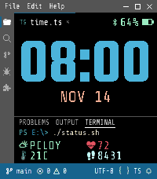
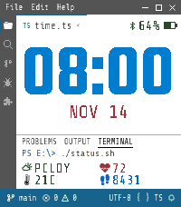
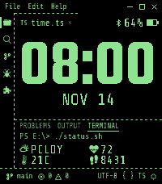
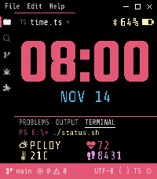
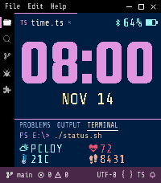
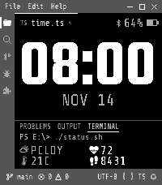

# IDE VSCode

     

A code editor watchface for the Pebble Time 2, laid out like Visual Studio Code.

## Features

- The time in 12-hour, 24-hour, or Swatch Internet Time (.beats), and the date in the format you pick.
- The weather as an icon and a short label such as CLEAR, PCLDY, or RAIN, with night icons after dark.
- The temperature, your heart rate, and your steps or distance in the terminal panel.
- The battery in the tab strip, and a bluetooth glyph that shows when the phone drops.
- Six editor themes.
- Optional buzzes on the hour and when the phone connects or drops.

## Installation

Download `ide-vscode-emery-<version>.pbw` from [Releases](https://github.com/AKlitbo/pebble-watchfaces/releases) and open it with the Pebble app on your phone. It runs on the Pebble Time 2 (Emery) only.

Enable Phone GPS is off on a new install, so pick a Manual Location or turn GPS on before the weather can show.

## Configuration

Open IDE VSCode's settings in the Pebble app.

| Section | Setting | What It Does |
| :-- | :-- | :-- |
| Appearance | Editor Theme | One of six, as shown at the top of this page. Dark by default. |
| Bluetooth | Show Connection Icon | The bluetooth glyph in the status bar, slashed when the phone drops. On by default. |
| Bluetooth | Vibrate on Connect | A short, long, or double buzz when the phone reconnects. None by default. |
| Bluetooth | Vibrate on Disconnect | A short, long, or double buzz when the phone drops. None by default. |
| Clock | Date Format | Such as JUN 18, the default, 2026-06-18, THU 18 JUN, or 2026.169 for the day of the year. |
| Clock | Time Format | System Default, the default, 12-hour, 24-hour, or .beats. |
| Clock | Hourly Vibration | A short, long, or double buzz on the hour, except during Quiet Time. None by default. |
| Health | Stats Readout | Steps, the default, or the distance walked in miles or kilometres. |
| Health | Battery | Icon + Percent, the default, Icon Only, or Percent Only. |
| Location Settings | Enable Phone GPS | The phone looks up where you are for the weather. Off by default. |
| Location Settings | Fallback to Manual Location | Uses the Manual Location when GPS cannot find you. On by default. |
| Location Settings | Manual Location | The city the weather is for when GPS is off or cannot find you. |
| Weather | Temperature Unit | Celsius, the default, or Fahrenheit. |
| Weather | Data Source | Open-Meteo, the default, OpenWeatherMap, or WeatherAPI.com. |
| Weather | API Key | Your OpenWeatherMap or WeatherAPI.com key. Open-Meteo needs none. |

### Getting an API Key

OpenWeatherMap and WeatherAPI.com each give a free key when you sign up.

- **OpenWeatherMap:** sign up at [openweathermap.org](https://openweathermap.org). The key is under API Keys in your account. A new key can take a couple of hours to start working.
- **WeatherAPI.com:** sign up at [weatherapi.com](https://www.weatherapi.com). The key is on your dashboard.

> [!WARNING]
> An API key is tied to your account. Don't share it or post it anywhere.

## Weather Sources

**The Place.** With Enable Phone GPS on, the weather is for where the phone is. When GPS cannot find you, the phone uses the Manual Location if Fallback to Manual Location is on, and fetches nothing if it is off.

**When It Refreshes.** Every 30 minutes, and straight away after you save a weather or location setting. That comes to about 50 calls a day, well inside either keyed source's free plan. The watch keeps the last good reading while a fetch fails.

## Credits

- **Weather Data:** [Open-Meteo](https://open-meteo.com) under [CC BY 4.0](https://creativecommons.org/licenses/by/4.0/), [OpenWeather](https://openweathermap.org), and [WeatherAPI.com](https://www.weatherapi.com).
- **Typography:** [Teko](https://fonts.google.com/specimen/Teko) and [Share Tech Mono](https://fonts.google.com/specimen/Share+Tech+Mono).
- **Weather Icons:** [Weather Icons](https://github.com/erikflowers/weather-icons) by Erik Flowers.
- **Bluetooth Icons:** Bluetooth on and slash icons from [SVG Repo](https://www.svgrepo.com).
- **Built With:** [Pebble SDK](https://developer.repebble.com) and [Clay](https://github.com/pebble-dev/clay).

The licences these come under are in [NOTICES](../../NOTICES.md).

## Changelog

Each release is in [CHANGELOG.md](CHANGELOG.md).

## Disclaimer

Visual Studio Code is a trademark of Microsoft. The **IDE VSCode** face is an unaffiliated homage and is not endorsed by or associated with Microsoft.
