# Gridlock

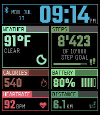 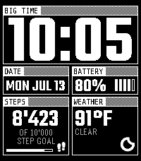 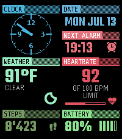 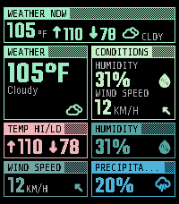 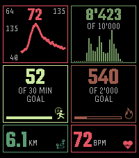 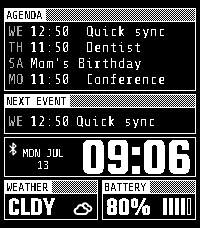 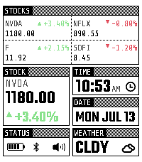 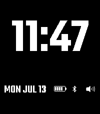 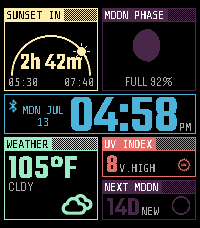 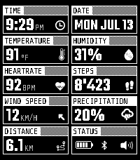 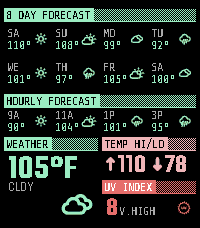 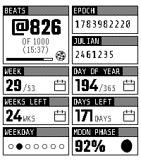 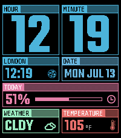 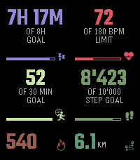 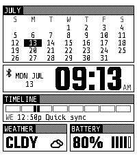 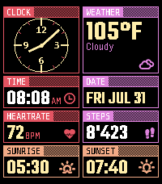 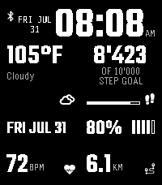 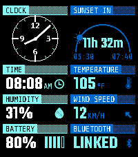 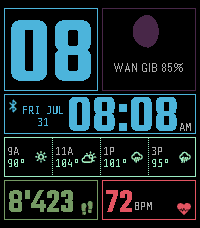 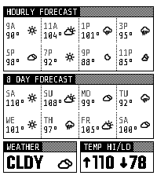 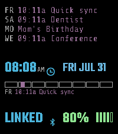 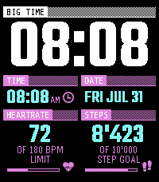 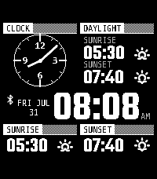 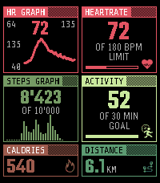 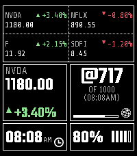 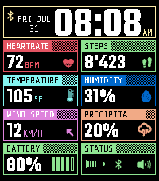 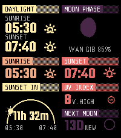 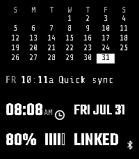 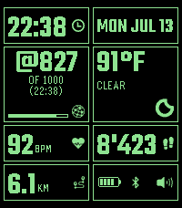 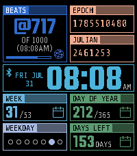 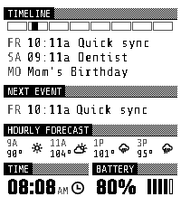 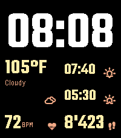

A grid watchface for the Pebble Time 2 that you fill with the panels you want. It's one of the Mosaic faces, which share their panels with [Sidereel](../sidereel/).

## Features

- A grid four cells wide and five tall, filled by dragging panels in four sizes onto it on the settings page.
- Up to five layouts, with a Night layout and a Quiet Time layout that can take over on their own.
- Clocks in many styles, including nine analog dials, big digits, .beats, and a second time zone.
- The date, a month grid, and progress through the hour, day, week, and year.
- The weather now, hourly and four-day forecasts, and the sun and the moon.
- Heart rate, HRV, steps, distance, calories, sleep, and active minutes, with goals and a buzz when you reach one.
- Your next events, with reminders before they start.
- A single stock, or a watchlist of up to four.
- The song your phone is playing, with its album art.
- The watch's battery and the phone's, the connection, Quiet Time, and your next alarm.
- Four themes, eight header fonts, and square or rounded panels.

## Installation

Gridlock comes as a watchface (`gridlock-face-emery-<version>.pbw`), which is the one on the appstore, and a watchapp (`gridlock-app-emery-<version>.pbw`) that lives in the launcher. They share a UUID, so only one can be on the watch at a time. Both run on the Pebble Time 2 (Emery) only, with watch firmware 4.44.3 or later.

1. **Install Gridlock.** Get it from the Pebble app store, or download the file you want from [Releases](https://github.com/AKlitbo/pebble-watchfaces/releases) and open it with the Pebble app on your phone.
2. **Turn Plugins On** for the weather, the calendar, or stocks from a plugin, or for the Phone Battery, Battery Battery, and Now Playing panels. In the Pebble app, go to Settings, Plugins, and turn on Plugins / permissions preview. Everything else works with plugins off.
3. **Build Your Layout.** Open Gridlock's settings in the Pebble app, pick a starter layout or drag panels onto the watch, and save.
4. **Fill In What Your Panels Need.** A calendar panel needs your iCal link or a calendar plugin, and a stock panel needs your symbols or a stock plugin. The weather works with nothing filled in.

## Configuration

Open Gridlock's settings in the Pebble app.

### Layout

| Setting | What It Does |
| :-- | :-- |
| The Layout Editor | Builds up to five layouts and picks the Day, Night, and Quiet Time ones. The starter layouts, Import / Export, and Clear sit beside the watch. |
| Swap Day & Night Layouts | Never, the default, At Sunset & Sunrise, or At Custom Times. |
| Night Starts and Night Ends | The custom times, 21:00 and 07:00 by default. At Sunset & Sunrise uses them too until the weather brings the sun times. |

**Panels That Need a Plugin.** A warning under the watch names any placed panel whose plugin is turned off or missing, and says what to do in the Pebble app.

### Appearance

| Setting | What It Does |
| :-- | :-- |
| Theme | One of four, as [Themes](#themes) covers. Mono (White on Black) by default. |
| Edit Panel Colours and Headers | Sets each panel's colours for the Custom theme, and turns its header and border on or off in every theme. |
| Header Font | From eight. Share Tech Mono by default. |
| Panel Style | Square, the default, or Rounded. |
| Analog Clock Style | The Analog Clock's dial, from nine. Classic (Round) by default. |

### Clock

| Setting | What It Does |
| :-- | :-- |
| Time Format | System Default, the default, 12-hour, or 24-hour. |
| Date Format | Such as THU JUN 18, the default, or 2026-06-18. |
| Week Starts On | Sunday, the default, or Monday. |
| Alternate Time Zone | The time on the Time Zone 1 panel. Search a city, or type UTC or an offset like UTC+05:30. |
| Hourly Vibration | A Short, Long, or Double buzz on the hour, except during Quiet Time. None by default. |

### Weather

| Setting | What It Does |
| :-- | :-- |
| Data Source | Where the weather comes from, as [Weather Sources](#weather-sources) covers. Open-Meteo by default, or the plugin on a new install while one serves the weather. |
| API Key | Your OpenWeatherMap or WeatherAPI.com key. Each source keeps its own. |
| Temperature Unit | Celsius, the default, or Fahrenheit. |
| Wind Speed Unit | km/h, the default, mph, knots, or m/s. |

### Weather Location

| Setting | What It Does |
| :-- | :-- |
| Use Phone GPS | The phone looks up where you are for the weather. On by default. |
| Fall Back to Manual Location | Uses the Manual Location when GPS cannot find you. On by default. |
| Manual Location | The city for the weather when GPS is off or cannot find you. |

### Calendar

| Setting | What It Does |
| :-- | :-- |
| Calendar Source | iCal Link or Pebble App: Preferred Source, shown only while a calendar plugin is on offer. The plugin by default, unless you saved an iCal link. |
| iCal Link | Your calendar's private iCal (`.ics`) address. |
| Refresh Interval | How often the phone downloads your calendar, 5 minutes to 1 hour. 30 minutes by default. |
| Event Reminders | Buzzes before a timed event while a calendar panel is placed, at 15 minutes, 5 minutes, and the start, at 5 minutes and the start, or at the start only. None by default, and quiet during Quiet Time. |
| 15-Minute Reminder, 5-Minute Reminder, and Start Reminder | The buzz for each reminder. Short, Double, and Long by default. |

### Stocks

| Setting | What It Does |
| :-- | :-- |
| Data Source | Where the quotes come from, as [Stock Sources](#stock-sources) covers. Yahoo by default, or the plugin on a new install while a stock plugin is installed. |
| API Key | Your key for the source, hidden for Yahoo. Each source keeps its own. |
| Paid Plan | Turn it on for a paid key, so Gridlock fetches on your Refresh Interval rather than the free plan's limits. Off by default. |
| Symbols | One symbol for the Stock panel, or up to four separated by commas for the Watchlist. |
| Refresh Interval | 1 to 30 minutes, 30 by default. |

### Health

| Setting | What It Does |
| :-- | :-- |
| Step Goal | 5,000 to 25,000 steps, 10,000 by default. |
| Steps Panel Shows | Steps, the default, or the distance walked in miles or kilometres. |
| Distance Goal | 2 to 20 km, 5 km by default. |
| Distance Unit | Kilometres, the default, or miles. |
| Calorie Goal | 500 to 3,000 kcal, 2,000 by default. |
| Activity Goal | 15 to 90 active minutes, 30 by default. |
| Sleep Goal | 6 to 10 hours, 8 by default. |
| Heart Rate Limit | The top of the 2×2 Heart Rate panel's bar, 150 to 200 bpm. 180 by default. |
| HRV Readings | Which readings the HRV panels count: Not While Walking, the default, Only When Still, or Any Time. Readings taken while walking run high. |
| Still Up To | How much your wrist can move for a reading to count as still, 30 to 200. 60 by default. |
| Walking From | How many steps during a reading make it a walk, 5 to 30. 10 by default. |
| Skip at Start | How many gaps between heartbeats each reading drops while the sensor settles, 3 to 20. 10 by default. |
| Goal Met Vibration | Buzzes the first time each day you reach a step, distance, calorie, or activity goal. Short, Long, Double, one of five fanfares, or Custom. None by default. |
| Custom Vibration Pattern | Your own buzz, as on and off times in milliseconds separated by commas, starting with a buzz. |

The HRV Tuning panel shows each reading's movement, steps, and skip count, to help set the last three HRV rows.

### Bluetooth

| Setting | What It Does |
| :-- | :-- |
| Vibrate on Connect and Vibrate on Disconnect | A Short, Long, or Double buzz when the phone reconnects or drops. None by default. |

**Plugins This Watchface Supports.** A panel at the foot of the page lists the plugins tested with Gridlock and marks the ones on your phone.

## Permissions

The Pebble app holds Gridlock to these while plugins are turned on.

- **Location:** for Use Phone GPS and for a weather plugin. Without it, a plugin's weather reads No Permission. Gridlock's own sources work without it while GPS is off and a Manual Location is set.
- **Internet:** any site, since your iCal link can be on any site. It also reaches the weather and stock sources and the searches on the settings page.
- **Calendar:** for the phone's calendars through Pebble App: Preferred Source.
- **Read Music:** for the Now Playing panels. The Pebble app shows it as "See what music is playing".

The Phone Battery panels and the stock plugins need no permission.

## Panels

Sizes are rows by columns. `1×2` and `2×2` are half the screen wide, and `1×4` and `2×4` span it. Panels marked \* only work with a Pebble app plugin, as [Phone Battery and Now Playing](#phone-battery-and-now-playing) covers.

> [!WARNING]
> Gridlock does not need plugins today, apart from the panels marked \*. If plugins ever become the default in the Pebble app, its own weather, calendar, and stock sources may be removed, and those panels would need a plugin as well.

### Starter Layouts

The settings page offers these to start from, shown here in the Vibrant theme. Change any panel and the layout is yours.

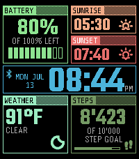 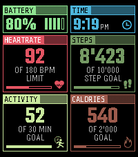 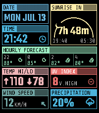 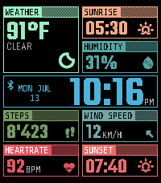 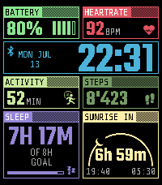 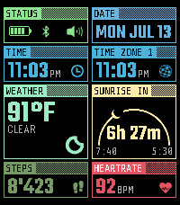

### 1×2

| | | | | | | |
|:--:|:--:|:--:|:--:|:--:|:--:|:--:|
| **Time (1×2)** 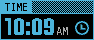 | **Date**  | **Time Zone 1** 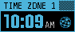 | **Week Number** 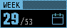 | **Weeks Left**  | **Day of Year** 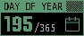 | **Days Left** 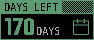 |
| **Weekday Dots** 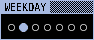 | **Julian Date** 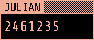 | **Epoch Clock** 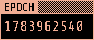 | **Beats**  | **Weather**  | **Temperature** 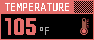 | **Feels Like**  |
| **Hi/Low** 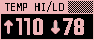 | **Humidity** 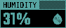 | **Wind Speed** 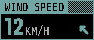 | **Precipitation**  | **UV**  | **Pressure**  | **Dew Point**  |
| **Sunrise**  | **Sunset**  | **Sun**  | **Moon**  | **Next Moon**  | **Heart Rate**  | **Steps**  |
| **Distance**  | **Calories**  | **Sleep**  | **Activity**  | **Battery**  | **Connection**  | **Quiet Time**  |
| **Status**  | **Next Alarm**  | **Year Progress**  | **Day Progress**  | **Hour Progress**  | **Week Progress**  | **Step Goal**  |
| **Distance Goal**  | **Calorie Goal**  | **Sleep Goal**  | **Activity Goal**  | **HRV**  | **HRV Trend**  | **Night HRV**  |
| **Phone Battery** \*  | **Battery Battery** \*  | | | | | |

### 2×2

| | | | | | | |
|:--:|:--:|:--:|:--:|:--:|:--:|:--:|
| **Digital Clock**  | **Big Hour**  | **Big Minutes**  | **Analog Clock**  | **Beats**  | **Weather**  | **Conditions**  |
| **UV**  | **Daylight**  | **Sun**  | **Moon**  | **Heart Rate**  | **HR Graph**  | **Steps**  |
| **Steps Graph**  | **Distance**  | **Calories**  | **Sleep**  | **Activity**  | **Next Event**  | **Timeline**  |
| **Stock**  | **Battery**  | **Next Alarm**  | **Year Progress**  | **Day Progress**  | **Hour Progress**  | **Week Progress**  |
| **Heart**  | **HRV History**  | **Still vs Walking**  | **Phone Battery** \*  | | | |

### 1×4

| | | |
|:--:|:--:|:--:|
| **Digital Clock**  | **Forecast (Hourly)**  | **Forecast (4-Day)**  |
| **Next Event**  | **Timeline**  | **Year Progress**  |
| **Day Progress**  | **Hour Progress**  | **Week Progress**  |
| **Step Goal**  | **Distance Goal**  | **Calorie Goal**  |
| **Sleep Goal**  | **Activity Goal**  | **HRV Today**  |
| **BPM Today**  | **Now Playing** \*  | |

### 2×4

| | | |
|:--:|:--:|:--:|
| **Big Time**  | **Forecast (Hourly)**  | **Forecast (4-Day)**  |
| **Agenda**  | **Timeline**  | **Watchlist**  |
| **Month Grid**  | **HRV Today**  | **BPM Today**  |
| **HRV Tuning**  | **Now Playing** \*  | |

## Themes

Mono (White on Black) is the classic look, and Mono (Black on White) flips it. Vibrant colours each panel by what it shows. Custom uses the colours you set under Edit Panel Colours and Headers.

## Weather Sources

- **Pebble App: Preferred Source:** the weather plugin you prefer in the Pebble app, such as its own Weather or Weather Enhanced. It needs plugins turned on.
- **Open-Meteo:** free, with no account or key.
- **OpenWeatherMap** and **WeatherAPI.com:** free tiers, each needing an account and an API key.

**From a Plugin.** The weather and forecasts follow the Pebble app's first weather location and its units, so Gridlock hides its own unit and location settings. The Pressure and Dew Point panels need a plugin that sends them, such as Weather Enhanced.

**From a Fetch.** OpenWeatherMap's free tier has no UV index, dew point, high and low, or chance of rain, so the phone fills those from Open-Meteo. With Use Phone GPS on, the weather is for where the phone is, and otherwise for the Manual Location.

**When It Refreshes.** Every 30 minutes, and straight away after you save a weather setting. The watch keeps the last good reading while a fetch fails.

## Calendar Sources

- **iCal Link:** any calendar with a private iCal link, such as Google Calendar's secret address, a public iCloud calendar, or a published Outlook calendar. A `webcal://` link works too.
- **Pebble App: Preferred Source:** the calendar plugin you prefer in the Pebble app. With its own Calendar plugin, that's the calendars switched on in the Pebble app's calendar settings. It needs plugins turned on.

> [!WARNING]
> Anyone who has a private iCal link can read that calendar. Treat it like a password.

**From an iCal Link.** The phone reads repeating events, moved and cancelled meetings, and time zones with [ical.js](https://github.com/kewisch/ical.js), and sends the watch only each event's start, end, title, and place. ical.js is under the MPL 2.0 and ships as a file of its own, as [NOTICES](../../../NOTICES.md) covers.

**When It Refreshes.** At your Refresh Interval, and when your phone comes back after being away. A failed download leaves the events on the watch as they were.

## Stock Sources

Stock shows the first symbol, and Watchlist up to four. Each source has a free plan, and all but Yahoo need an account and an API key.

- **Pebble App: Preferred Source:** a stock plugin from the Pebble app store, such as Stocks or Stocks + Crypto. Set its tickers in the plugin's own settings, and the panels show its first four.
- **Yahoo:** real-time, no API key, and the most markets, including indices and crypto. It's an unofficial feed, so it can break without notice.
- **Finnhub:** real-time, but its free plan covers US stocks only and shows NO ACCESS for anything else, such as `^GSPC`.
- **Twelve Data:** US markets on a free key, and more than 20 others on a paid plan. A free key fetches no more often than every 15 minutes while the US market is open, and every 3 hours while it's shut, to stay inside its 800 calls a day.
- **Alpha Vantage:** the day's close only. A free key fetches it on weekday evenings, New York time, to stay inside its 25 calls a day.

**What Reaches the Watch.** Each slot shows the ticker, its last price, and the day's change in percent. A symbol can be outside the US, an index, or a currency pair, such as `7203.T`, `^GSPC`, `EURUSD=X`, or `BTC/USD`, where the source covers it, and the watch shows its first 11 characters. A symbol that cannot be priced shows a word such as NO SYMBOL or INVALID KEY, and a failed fetch keeps the last good price.

**When It Refreshes.** At your Refresh Interval, within the limits above, and straight away after you save the source, the key, or the symbols.

## Phone Battery and Now Playing

Phone Battery and Battery Battery read your phone's battery from the Pebble app's Phone plugin, so they need plugins turned on. With plugins off, Phone Battery reads PLUGINS OFF and Battery Battery's phone half reads OFF. Both show two dashes while your phone is away.

Now Playing shows the song your phone is playing, with its title, artist, and album art, and the 2×4 adds whether it's paused. It reads the Pebble app's music plugin, which is built in on Android, so it needs plugins turned on too.

## Known Limitations

**Weather**

- With the plugin picked and plugins turned off in the Pebble app, the weather reads No Plugin until they are back on.

**Calendar**

- Gridlock reads one iCal link. The Calendar + iCal plugin merges up to two links with the phone's calendars, for use through Pebble App: Preferred Source.
- The watch holds the next six events, from today through the next six days. Titles are cut to 24 characters and places to 16.
- With the plugin picked and plugins turned off in the Pebble app, the calendar panels keep the events they have until plugins are back on.

**Stocks**

- With the plugin picked and plugins turned off in the Pebble app, the first slot reads NO PLUGIN until they are back on.
- The schedule knows weekends but not market holidays, so Twelve Data and Alpha Vantage spend calls on a US holiday, still inside their free plans.

**Phone Battery and Now Playing**

- On an iPhone, the phone's battery moves in steps of 5 percent, and Now Playing has no music plugin and no album art yet.
- The watch fonts carry plain Latin letters only, so a title or artist in another script, such as Japanese, comes through blank.

## Credits

- **Typography:** [Teko](https://fonts.google.com/specimen/Teko) and [Share Tech Mono](https://fonts.google.com/specimen/Share+Tech+Mono) for the clock and values, with [LECO 2014](https://www.1001fonts.com/leco-2014-font.html), [Press Start 2P](https://fonts.google.com/specimen/Press+Start+2P), [Pixelify Sans](https://fonts.google.com/specimen/Pixelify+Sans), [Aldrich](https://fonts.google.com/specimen/Aldrich), [Kode Mono](https://fonts.google.com/specimen/Kode+Mono), [Electrolize](https://fonts.google.com/specimen/Electrolize), and [Quantico](https://fonts.google.com/specimen/Quantico) as header options.
- **Glyphs:** Heart, step, distance, thermometer, UV, fire, snooze, late, clock, globe, calendar, alarm, volume, and watch and phone charging icons from [UXWing](https://uxwing.com).
- **Weather Icons:** [Erik Flowers](https://github.com/erikflowers/weather-icons), for the weather and the moon phases.
- **Bluetooth Icons:** Bluetooth on and slash icons from [SVG Repo](https://www.svgrepo.com).
- **Calendar Reading:** [ical.js](https://github.com/kewisch/ical.js) by Philipp Kewisch.
- **Weather Data:** [Open-Meteo](https://open-meteo.com), under [CC BY 4.0](https://creativecommons.org/licenses/by/4.0/). Weather data © [OpenWeather](https://openweathermap.org). Powered by [WeatherAPI.com](https://www.weatherapi.com).
- **Built With:** [Pebble SDK](https://developer.repebble.com) and [Clay](https://github.com/pebble-dev/clay).

The licences these come under are in [NOTICES](../../../NOTICES.md).

## Changelog

Each release is in [CHANGELOG.md](CHANGELOG.md).
