# Sidereel

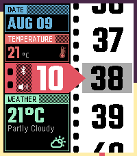 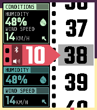 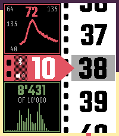  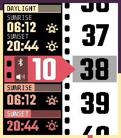 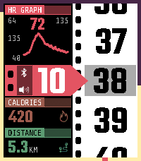 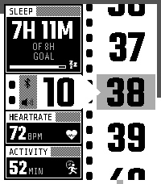 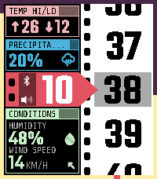 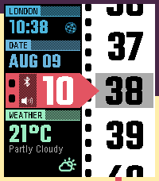 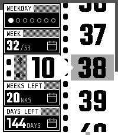 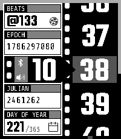 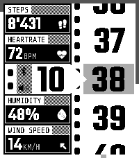 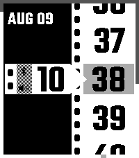 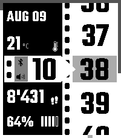 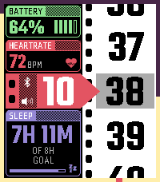 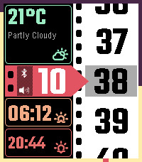 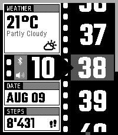 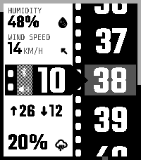 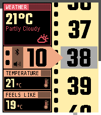 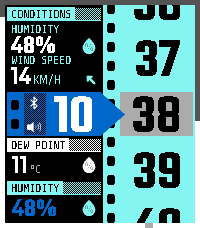 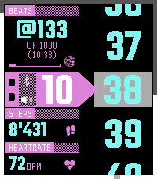 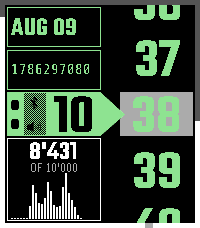 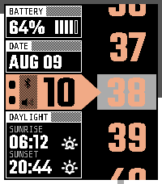 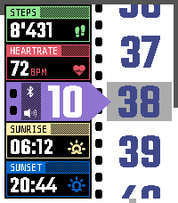

A film reel watchface for the Pebble Time 2, where the minutes roll past a pointer carrying the hour. It's one of the Mosaic faces, which share their panels with [Gridlock](../gridlock/).

## Features

- The minutes on a scrolling reel, and the hour on a pointer beside it.
- A day track around the edge, with the daylight shaded.
- Panels in two sizes on the left of the face, dragged into place on the settings page.
- Up to five layouts, with a Night layout and a Quiet Time layout that can take over on their own.
- The date, day and week counts, .beats, the Unix time, the Julian date, a second time zone, and progress through the hour, day, week, and year.
- The weather now, and the sun and the moon.
- Heart rate, steps, distance, calories, sleep, and active minutes, with goals and a buzz when you reach one.
- The watch's battery and the phone's, and your next alarm, with bluetooth and Quiet Time glyphs on the pointer.
- Four themes, your own pointer and reel colours, eight header fonts, and square or rounded panels.
- Optional buzzes on the hour and when the phone connects or drops.

## Installation

1. **Install Sidereel.** Download `sidereel-emery-<version>.pbw` from [Releases](https://github.com/AKlitbo/pebble-watchfaces/releases) and open it with the Pebble app on your phone. It runs on the Pebble Time 2 (Emery) only, with watch firmware 4.44.3 or later.
2. **Turn Plugins On** for the weather from a plugin, or for the Phone Battery and Battery Battery panels. In the Pebble app, go to Settings, Plugins, and turn on Plugins / permissions preview. Everything else works with plugins off.
3. **Build Your Layouts** on Sidereel's settings page in the Pebble app.

## Configuration

Open Sidereel's settings in the Pebble app.

### Appearance

| Setting | What It Does |
| :-- | :-- |
| Theme | One of four, as [Themes](#themes) covers. Mono (White on Black) by default. |
| Set Face Colours Yourself | Paints the pointer and the reel in your own colours, over any theme. Off by default. |
| Pointer Colour, Pointer Text Colour, Reel Colour, and Reel Text Colour | The four face colours. A red pointer with white text and a white reel with black minutes by default, which Reset Face Colours puts back. |
| Edit Panel Colours and Headers | Sets each panel's colours for the Custom theme, and turns its header and border on or off in every theme. |
| Header Font | From eight. Share Tech Mono by default. |
| Panel Style | Square, the default, or Rounded. |
| Show Quiet Time Icon | A speaker on the pointer, muted during Quiet Time. Off by default. |
| Reduce Motion | Steps the reel to each new minute rather than scrolling it. Off by default. |

### Layout

| Setting | What It Does |
| :-- | :-- |
| The Layout Editor | Builds up to five layouts and picks the Day, Night, and Quiet Time ones. The starter layouts, Import / Export, and Clear sit beside the watch. |
| Swap Day & Night Layouts | Never, the default, At Sunset & Sunrise, or At Custom Times. |
| Night Starts and Night Ends | The custom times, 21:00 and 07:00 by default. At Sunset & Sunrise uses them too until the weather brings the sun times. |

**Panels That Need a Plugin.** A warning under the watch names any placed panel whose plugin is turned off or missing, and says what to do in the Pebble app.

### Bluetooth

| Setting | What It Does |
| :-- | :-- |
| Show Connection Icon | A bluetooth glyph on the pointer, slashed when the phone drops. On by default. |
| Vibrate on Connect and Vibrate on Disconnect | A Short, Long, or Double buzz when the phone reconnects or drops. None by default. |

### Clock

| Setting | What It Does |
| :-- | :-- |
| Time Format | System Default, the default, 12-hour, or 24-hour. |
| Date Format | How the Date panel writes the date, such as JUN 18, the default, or 2026-06-18. |
| Hourly Vibration | A Short, Long, or Double buzz on the hour, except during Quiet Time. None by default. |
| Week Starts On | Sunday, the default, or Monday. |
| Alternate Time Zone | The time on the Time Zone 1 panel. Search a city, or type UTC or an offset like UTC+05:30. |

### Health

| Setting | What It Does |
| :-- | :-- |
| Step Goal | 5,000 to 25,000 steps, 10,000 by default. |
| Steps Panel Shows | Steps, the default, or the distance walked in miles or kilometres. |
| Distance Goal | 2 to 20 km, 5 km by default. |
| Distance Unit | Kilometres, the default, or miles. |
| Calorie Goal | 500 to 3,000 kcal, 2,000 by default. |
| Activity Goal | 15 to 90 active minutes, 30 by default. |
| Sleep Goal | 6 to 10 hours, 8 by default. |
| Heart Rate Limit | The top of the 2×2 Heart Rate panel's bar, 150 to 200 bpm. 180 by default. |
| Goal Met Vibration | Buzzes the first time each day you reach a step, distance, calorie, or activity goal. Short, Long, Double, one of five fanfares, or Custom. None by default. |
| Custom Vibration Pattern | Your own buzz, as on and off times in milliseconds separated by commas, starting with a buzz. |

### Weather

| Setting | What It Does |
| :-- | :-- |
| Data Source | Where the weather comes from, as [Weather Sources](#weather-sources) covers. Open-Meteo by default, or the plugin on a new install while one serves the weather. |
| API Key | Your OpenWeatherMap or WeatherAPI.com key. Each source keeps its own. |
| Temperature Unit | Celsius, the default, or Fahrenheit. |
| Wind Speed Unit | km/h, the default, mph, knots, or m/s. |

### Weather Location

| Setting | What It Does |
| :-- | :-- |
| Use Phone GPS | The phone looks up where you are for the weather. On by default. |
| Fall Back to Manual Location | Uses the Manual Location when GPS cannot find you. On by default. |
| Manual Location | The city for the weather when GPS is off or cannot find you. |

**Plugins This Watchface Supports.** A panel at the foot of the page lists the plugins tested with Sidereel and marks the ones on your phone.

## Permissions

- **Location:** for Use Phone GPS and for a weather plugin. Without it, a plugin's weather reads No Permission.
- **Internet for `open-meteo.com`, `openweathermap.org`, and `weatherapi.com`:** the phone calls only your Data Source, plus Open-Meteo for what the others leave out and for the searches on the settings page.

The Phone Battery panels need no permission.

## Panels

Panels sit in the left half of the face, two rows above the hour pointer and two below. Sizes are rows by columns, and both are half the screen wide. Sidereel reads the time off its reel, so it has no clock panels. The calendar, stock, forecast, Month Grid, HRV, Now Playing, connection, Quiet Time, and status panels are on Gridlock only.

Panels marked \* only work with a Pebble app plugin, as [Phone Battery](#phone-battery) covers.

> [!WARNING]
> Sidereel does not need plugins today, apart from the panels marked \*. If plugins ever become the default in the Pebble app, its own weather sources may be removed, and the weather panels would need a plugin as well.

### Starter Layouts

The settings page offers these to start from, shown here in the Vibrant theme. Change any panel and the layout is yours.

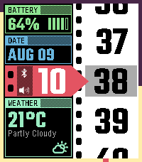 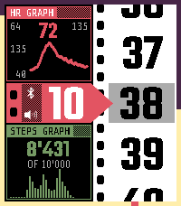 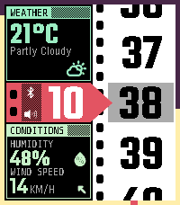 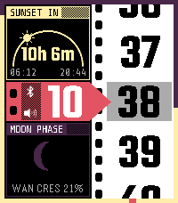 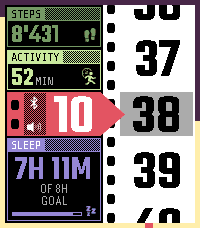

### 1×2

| | | | | | | |
|:--:|:--:|:--:|:--:|:--:|:--:|:--:|
| **Date**  | **Time Zone 1** 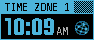 | **Week Number** 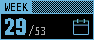 | **Weeks Left**  | **Day of Year** 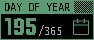 | **Days Left** 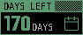 | **Weekday Dots** 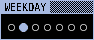 |
| **Julian Date** 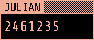 | **Epoch Clock** 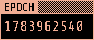 | **Beats**  | **Weather**  | **Temperature** 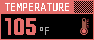 | **Feels Like** 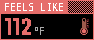 | **Hi/Low** 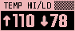 |
| **Humidity** 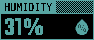 | **Wind Speed** 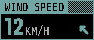 | **Precipitation** 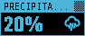 | **UV**  | **Pressure** 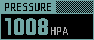 | **Dew Point** 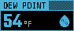 | **Sunrise** 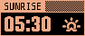 |
| **Sunset** 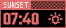 | **Sun** 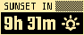 | **Moon** 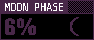 | **Next Moon**  | **Heart Rate** 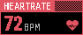 | **Steps** 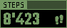 | **Distance** 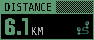 |
| **Calories**  | **Sleep**  | **Activity**  | **Battery**  | **Next Alarm**  | **Year Progress**  | **Day Progress**  |
| **Hour Progress**  | **Week Progress**  | **Step Goal**  | **Distance Goal**  | **Calorie Goal**  | **Sleep Goal**  | **Activity Goal**  |
| **Phone Battery** \*  | **Battery Battery** \*  | | | | | |

### 2×2

| | | | | | | |
|:--:|:--:|:--:|:--:|:--:|:--:|:--:|
| **Beats**  | **Weather**  | **Conditions**  | **UV**  | **Daylight**  | **Sun**  | **Moon**  |
| **Heart Rate**  | **HR Graph**  | **Steps**  | **Steps Graph**  | **Distance**  | **Calories**  | **Sleep**  |
| **Activity**  | **Battery**  | **Next Alarm**  | **Year Progress**  | **Day Progress**  | **Hour Progress**  | **Week Progress**  |
| **Phone Battery** \*  | | | | | | |

## Themes

Mono (White on Black) is the classic look, and Mono (Black on White) flips it. Vibrant colours each panel by what it shows and gives the pointer its red. Custom uses the colours you set under Edit Panel Colours and Headers.

## Weather Sources

- **Pebble App: Preferred Source:** the weather plugin you prefer in the Pebble app, such as its own Weather or Weather Enhanced. It needs plugins turned on.
- **Open-Meteo:** free, with no account or key.
- **OpenWeatherMap** and **WeatherAPI.com:** free tiers, each needing an account and an API key.

**From a Plugin.** The weather follows the Pebble app's first weather location and its units, so Sidereel hides its own unit and location settings. The Pressure and Dew Point panels need a plugin that sends them, such as Weather Enhanced.

**From a Fetch.** OpenWeatherMap's free tier has no UV index, dew point, high and low, or chance of rain, so the phone fills those from Open-Meteo. With Use Phone GPS on, the weather is for where the phone is, and otherwise for the Manual Location.

**When It Refreshes.** Every 30 minutes, and straight away after you save a weather setting. The watch keeps the last good reading while a fetch fails.

## Phone Battery

Phone Battery and Battery Battery read your phone's battery from the Pebble app's Phone plugin, so they need plugins turned on. With plugins off, Phone Battery reads PLUGINS OFF and Battery Battery's phone half reads OFF. Both show two dashes while your phone is away.

## Known Limitations

- With the weather plugin picked and plugins turned off in the Pebble app, the weather reads No Plugin until they are back on.

## Credits

- **Typography:** [Teko](https://fonts.google.com/specimen/Teko) and [Share Tech Mono](https://fonts.google.com/specimen/Share+Tech+Mono) for the clock and values, with [LECO 2014](https://www.1001fonts.com/leco-2014-font.html), [Press Start 2P](https://fonts.google.com/specimen/Press+Start+2P), [Pixelify Sans](https://fonts.google.com/specimen/Pixelify+Sans), [Aldrich](https://fonts.google.com/specimen/Aldrich), [Kode Mono](https://fonts.google.com/specimen/Kode+Mono), [Electrolize](https://fonts.google.com/specimen/Electrolize), and [Quantico](https://fonts.google.com/specimen/Quantico) as header options.
- **Glyphs:** Heart, step, distance, thermometer, UV, fire, snooze, late, clock, globe, calendar, alarm, volume, and watch and phone charging icons from [UXWing](https://uxwing.com).
- **Weather Icons:** [Erik Flowers](https://github.com/erikflowers/weather-icons), for the weather and the moon phases.
- **Bluetooth Icons:** Bluetooth on and slash icons from [SVG Repo](https://www.svgrepo.com).
- **Weather Data:** [Open-Meteo](https://open-meteo.com), under [CC BY 4.0](https://creativecommons.org/licenses/by/4.0/). Weather data © [OpenWeather](https://openweathermap.org). Powered by [WeatherAPI.com](https://www.weatherapi.com).
- **Built With:** [Pebble SDK](https://developer.repebble.com) and [Clay](https://github.com/pebble-dev/clay).

The licences these come under are in [NOTICES](../../../NOTICES.md).

## Changelog

Each release is in [CHANGELOG.md](CHANGELOG.md).
