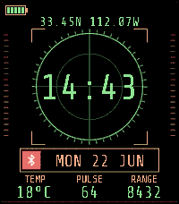
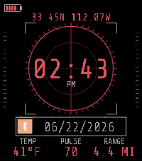
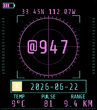
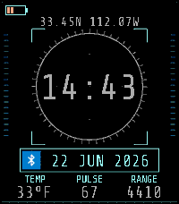
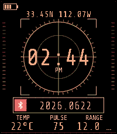
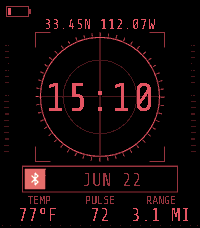
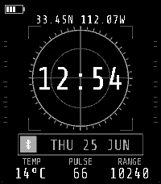

# Radar Array

      

A radar screen watchface for the Pebble Time 2, with the time in the middle of the scope.

## Features

- The time in 12-hour, 24-hour, or Swatch Internet Time (.beats), with AM or PM under a 12-hour clock, and the date in the format you pick.
- The latitude and longitude the weather was fetched for, such as 34.05N 118.24W.
- The temperature, your heart rate, and your steps or distance, as TEMP, PULSE, and RANGE.
- A five-segment battery gauge, and a bluetooth glyph that shows when the phone drops.
- Seven frame themes.
- Optional buzzes on the hour and when the phone connects or drops.

## Installation

Download `radar-array-emery-<version>.pbw` from [Releases](https://github.com/AKlitbo/pebble-watchfaces/releases) and open it with the Pebble app on your phone. It runs on the Pebble Time 2 (Emery) only.

## Configuration

Open Radar Array's settings in the Pebble app.

| Section | Setting | What It Does |
| :-- | :-- | :-- |
| Appearance | Frame Theme | One of seven, as shown at the top of this page. Starts on Default. |
| Bluetooth | Show Connection Icon | The bluetooth glyph beside the date, slashed when the phone drops. On by default. |
| Bluetooth | Vibrate on Connect | A short, long, or double buzz when the phone reconnects. None by default. |
| Bluetooth | Vibrate on Disconnect | A short, long, or double buzz when the phone drops. None by default. |
| Clock | Date Format | Such as 2026.0618, JUN 18 2026, THU 18 JUN, the default, or 2026.169 for the day of the year. |
| Clock | Time Format | System Default, the default, 12-hour, 24-hour, or .beats. |
| Clock | Hourly Vibration | A short, long, or double buzz on the hour, except during Quiet Time. None by default. |
| Health | Range Readout | Steps, the default, or the distance walked in miles or kilometres. |
| Location Settings | Enable Phone GPS | The phone looks up where you are for the weather. On by default. |
| Location Settings | Fallback to Manual Location | Uses the Manual Location when GPS cannot find you. On by default. |
| Location Settings | Manual Location | The city the weather is for when GPS is off or cannot find you. |
| Weather | Temperature Unit | Celsius, the default, or Fahrenheit. |
| Weather | Data Source | Open-Meteo, the default, OpenWeatherMap, or WeatherAPI.com. |
| Weather | API Key | Your OpenWeatherMap or WeatherAPI.com key. Open-Meteo needs none. |

### Getting an API Key

OpenWeatherMap and WeatherAPI.com each give a free key when you sign up.

- **OpenWeatherMap:** sign up at [openweathermap.org](https://openweathermap.org). The key is under API Keys in your account. A new key can take a couple of hours to start working.
- **WeatherAPI.com:** sign up at [weatherapi.com](https://www.weatherapi.com). The key is on your dashboard.

> [!WARNING]
> An API key is tied to your account. Don't share it or post it anywhere.

## Weather Sources

**The Place.** With Enable Phone GPS on, the weather is for where the phone is. When GPS cannot find you, the phone uses the Manual Location if Fallback to Manual Location is on, and fetches nothing if it is off.

**When It Refreshes.** Every 30 minutes, and straight away after you save a weather or location setting. That comes to about 50 calls a day, well inside either keyed source's free plan. The watch keeps the last good temperature while a fetch fails.

## Credits

- **Weather Data:** [Open-Meteo](https://open-meteo.com) under [CC BY 4.0](https://creativecommons.org/licenses/by/4.0/), [OpenWeather](https://openweathermap.org), and [WeatherAPI.com](https://www.weatherapi.com).
- **Typography:** [Share Tech Mono](https://fonts.google.com/specimen/Share+Tech+Mono).
- **Bluetooth Icons:** Bluetooth on and slash icons from [SVG Repo](https://www.svgrepo.com).
- **Built With:** [Pebble SDK](https://developer.repebble.com) and [Clay](https://github.com/pebble-dev/clay).

The licences these come under are in [NOTICES](../../NOTICES.md).

## Changelog

Each release is in [CHANGELOG.md](CHANGELOG.md).
