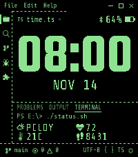
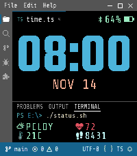
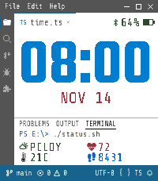
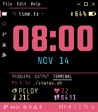
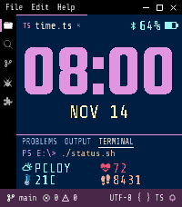
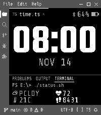

# Runtime

        

A watchface for the Pebble Time 2 that puts the time on an old or new computer screen, from a VS Code editor to a DOS prompt. It was called IDE VSCode before 2.0.0.

## Features

- Six desktops: VSCode IDE, Desktop 95, Desktop 2000, DOS Norton Commander, DOS Turbo C++ IDE, and NetBeans IDE.
- Six themes for VSCode IDE, and a Classic, Dark, and green on black Terminal look for each of the others.
- The time in 12-hour, 24-hour, or Swatch Internet Time (.beats), and the date in the format you pick.
- The weather as an icon and a short label, the temperature, your heart rate, and your steps or distance.
- The battery, a bluetooth glyph, and a Quiet Time glyph while Quiet Time is on.
- Optional buzzes on the hour and when the phone connects or drops.

## Installation

1. **Install the Watchface.** Download `runtime-emery-<version>.pbw` from [Releases](https://github.com/AKlitbo/pebble-watchfaces/releases) and open it with the Pebble app on your phone. It runs on the Pebble Time 2 (Emery) only, and needs watch firmware 4.44.3 or later.
2. **Allow Its Permissions** when the Pebble app asks, as [Permissions](#permissions) covers.
3. **Set Up the Weather.** Enable Phone GPS is off on a new install, so pick a Manual Location or turn GPS on before the weather can show.
4. **Turn Plugins On** to use a weather plugin. In the Pebble app, go to Settings, Plugins, and turn on Plugins / permissions preview, then pick Pebble App: Preferred Source as the Data Source.

## Configuration

Open Runtime's settings in the Pebble app.

| Section | Setting | What It Does |
| :-- | :-- | :-- |
| Appearance | Desktop | Which computer the watchface is drawn as. VSCode IDE by default. |
| Appearance | Editor Theme | One of six for VSCode IDE, with a picture of each. Dark by default. |
| Appearance | Desktop Theme | Classic, Dark, or Terminal for every other desktop, with a picture of each. Classic by default. |
| Bluetooth | Show Connection Icon | The bluetooth glyph beside the battery, slashed when the phone drops. On by default. |
| Bluetooth | Vibrate on Connect and Vibrate on Disconnect | A Short, Long, or Double buzz when the phone reconnects or drops. None by default. |
| Clock | Date Format | Such as JUN 18, the default, 2026-06-18, THU 18 JUN, or 2026.169 for the day of the year. |
| Clock | Time Format | System Default, the default, 12-hour, 24-hour, or .beats. |
| Clock | Hourly Vibration | A Short, Long, or Double buzz on the hour, except during Quiet Time. None by default. |
| Weather | Temperature Unit | Celsius, the default, or Fahrenheit. |
| Weather | Data Source | Where the weather comes from, as [Weather Sources](#weather-sources) covers. Open-Meteo by default, or the plugin on a new install while one serves the weather. |
| Weather | API Key | Your OpenWeatherMap or WeatherAPI.com key. Each source keeps its own. |
| Location Settings | Enable Phone GPS | The phone looks up where you are for the weather. Off by default. |
| Location Settings | Fallback to Manual Location | Uses the Manual Location when GPS cannot find you. On by default. |
| Location Settings | Manual Location | The city the weather is for when GPS is off or cannot find you. |
| Health | Stats Readout | Steps, the default, or the distance walked in miles or kilometres. |
| Health | Battery | Icon + Percent, the default, Icon Only, or Percent Only. DOS Norton Commander and DOS Turbo C++ IDE always show the percentage. |

**Plugins This Watchface Supports.** A closed panel at the foot of the page lists the weather plugins tested with Runtime and marks the ones on your phone.

## Permissions

The Pebble app asks for these while Plugins / permissions preview is on. None is required, so allow only what your weather source uses. After an update that asks for new permissions, the weather stays empty until you allow them.

- **Location:** for Enable Phone GPS and for a weather plugin.
- **Internet for `open-meteo.com`, `openweathermap.org`, and `weatherapi.com`:** for the weather source you pick, and the Manual Location search.

## Weather Sources

- **Open-Meteo:** free, with no account or key.
- **OpenWeatherMap** and **WeatherAPI.com:** free tiers, each needing an account and an API key.
- **Pebble App: Preferred Source:** the weather plugin you prefer in the Pebble app, such as its built-in Weather or one from the Pebble app store. It shows once plugins are on and a plugin on your phone serves the weather.

> [!WARNING]
> Runtime does not need plugins today. If plugins ever become the default in the Pebble app, its own sources may be removed, and the weather would need a plugin.

**The Place.** With Enable Phone GPS on, the weather is for where the phone is, and otherwise for the Manual Location. A plugin's weather follows the Pebble app's first weather location and its units, so the face hides its own unit and location settings.

**Refreshing.** Every 30 minutes, and straight away after you save a weather setting. The watch keeps the last good weather while a fetch fails.

## Known Limitations

* The Quiet Time glyph appears or goes at the next minute's redraw, not the moment Quiet Time changes.

## Credits

- **Typography:** [Teko](https://fonts.google.com/specimen/Teko), [Share Tech Mono](https://fonts.google.com/specimen/Share+Tech+Mono), [VT323](https://fonts.google.com/specimen/VT323), and [Cousine](https://fonts.google.com/specimen/Cousine).
- **Glyphs:** Heart, step, thermometer, speaker, folder, search, extension, bug, save, and hammer icons from [UXWing](https://uxwing.com), and the branch icon from [Phosphor](https://phosphoricons.com).
- **Weather Icons:** [Weather Icons](https://github.com/erikflowers/weather-icons) by Erik Flowers.
- **Weather Data:** [Open-Meteo](https://open-meteo.com), under [CC BY 4.0](https://creativecommons.org/licenses/by/4.0/). Weather data © [OpenWeather](https://openweathermap.org). Powered by [WeatherAPI.com](https://www.weatherapi.com).
- **Built With:** [Pebble SDK](https://developer.repebble.com) and [Clay](https://github.com/pebble-dev/clay).

The licences these come under are in [NOTICES](../../NOTICES.md).

## Changelog

Each release is in [CHANGELOG.md](CHANGELOG.md).

## Disclaimer

Visual Studio Code is a trademark of Microsoft, Apache NetBeans and NetBeans are trademarks of The Apache Software Foundation, Norton Commander is a trademark of Gen Digital Inc., and Turbo C++ is a trademark of Embarcadero Technologies. Runtime's desktops are unaffiliated homages and are not endorsed by or associated with any of them.
