# Sketchbook Horizon

**Pebble Time 2**

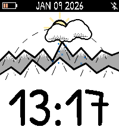 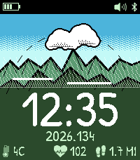 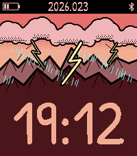 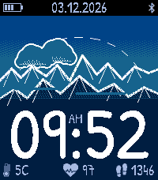 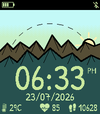 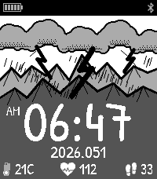 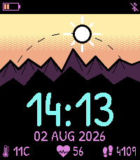 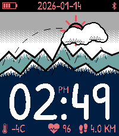 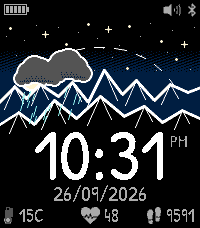 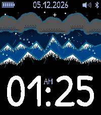 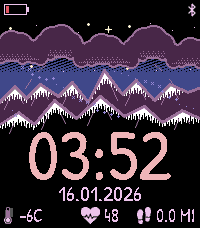 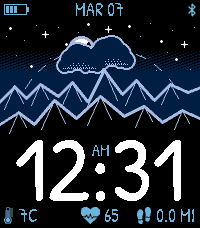 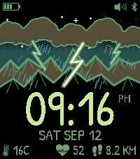 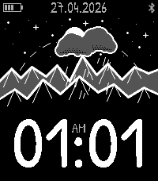 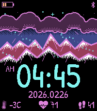 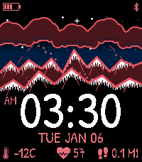

**Pebble Round 2**

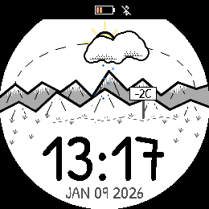 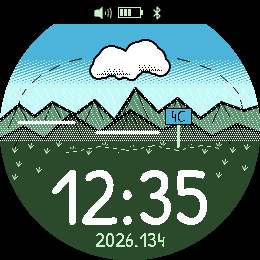 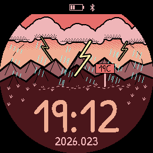 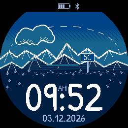 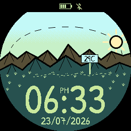 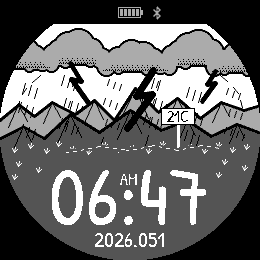 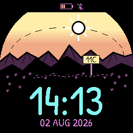 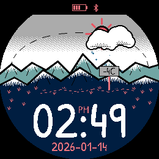 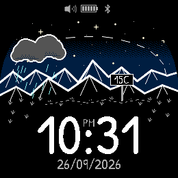 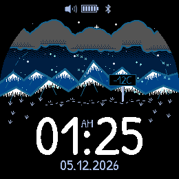 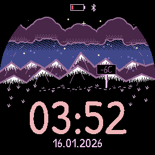 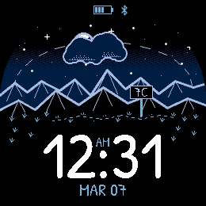 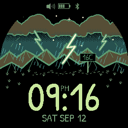 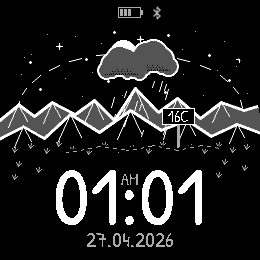 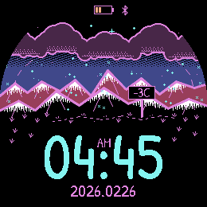 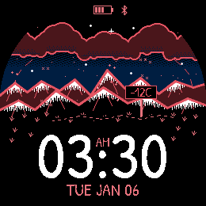

A hand-drawn landscape watchface for the Pebble Time 2 and the Pebble Round 2, with the sky drawn from your weather.

## Features

- Eight scenes: the landscapes Ridgeline, Shoreline, Skyline, and Treeline, and the landmarks Mount Fuji, Giza, Half Dome, and Uluru.
- A sky that follows the real sunrise and sunset, with the moon at tonight's phase.
- Weather drawn into the scene, from snow on the peaks to a choppy sea and the cabin's smoke leaning with the wind.
- Eight palettes, each with a day and a night version.
- A Palette Mode that keeps one palette, shuffles through them, or swaps at night and during Quiet Time.
- The time in 12-hour, 24-hour, or Swatch Internet Time (.beats), and the date in the format you pick.
- The temperature, your heart rate, and your steps or distance in a stats row on the Pebble Time 2.
- A battery gauge, a bluetooth glyph, and an optional Quiet Time glyph.
- Optional buzzes on the hour and when the phone connects or drops.

## Installation

1. **Install the Watchface.** Download `sketchbook-horizon-<version>.pbw` from [Releases](https://github.com/AKlitbo/pebble-watchfaces/releases) and open it with the Pebble app on your phone. The one file installs on the Pebble Time 2 (Emery) and the Pebble Round 2 (Gabbro), and needs watch firmware 4.44.3 or later.
2. **Allow Its Permissions** when the Pebble app asks, as [Permissions](#permissions) covers.
3. **Pick a Weather Source** under Weather on the settings page. Open-Meteo works with no setup.
4. **Use a Weather Plugin** if you like. Pick Pebble App: Preferred Source as the Data Source, which shows once a plugin on your phone serves the weather.

## Configuration

Open Sketchbook Horizon's settings in the Pebble app.

| Section | Setting | What It Does |
| :-- | :-- | :-- |
| Appearance | Scene | Ridgeline, Shoreline, Skyline, Treeline, Mount Fuji, Giza, Half Dome, or Uluru. Ridgeline by default. |
| Appearance | Scene Palette | One of eight, with a preview of each under the picker. Sketchbook by default. |
| Appearance | Palette Mode | Fixed, the default, keeps the Scene Palette. Shuffle rotates through all eight. Day / Night / Quiet can swap in another after dark or during Quiet Time. |
| Appearance | Shuffle Every | How long each palette stays up in Shuffle mode, from 15 minutes to a day. Hour by default. |
| Appearance | Use Night Palette and Night Palette | Paints the Night Palette after dark. Off by default. |
| Appearance | Use Quiet Time Palette and Quiet Time Palette | Paints the Quiet Time Palette during Quiet Time, even at night. Off by default. |
| Appearance | Layout | Balanced, the default, puts the date under the clock and the stats along the bottom. Time Focused moves the date to the top bar for a bigger clock. Clock Only drops the stats too. Pebble Time 2 only. |
| Appearance | Show Quiet Time Icon | A speaker next to bluetooth, muted during Quiet Time. Off by default. |
| Bluetooth | Show Connection Icon | The bluetooth glyph in the top bar, slashed when the phone drops. On by default. |
| Bluetooth | Vibrate on Connect and Vibrate on Disconnect | A Short, Long, or Double buzz when the phone reconnects or drops. None by default. |
| Clock | Date Format | Such as 2026.0618 or THU 18 JUN, the default. The .beat formats add .beats to the date. |
| Clock | Time Format | System Default, the default, 12-hour, 24-hour, or .beats. |
| Clock | Show AM/PM | The AM/PM marker on a 12-hour clock. On by default. |
| Clock | Hourly Vibration | A Short, Long, or Double buzz on the hour, except during Quiet Time. None by default. |
| Health | Tracks Readout | Steps, the default, or the distance in miles or kilometres. Pebble Time 2 only. |
| Weather | Temperature Unit | Celsius, the default, or Fahrenheit. |
| Weather | Data Source | Where the weather comes from, as [Weather Sources](#weather-sources) covers. Open-Meteo by default, or the plugin on a new install while one serves the weather. |
| Weather | API Key | Your OpenWeatherMap or WeatherAPI.com key. Each source keeps its own. |
| Location Settings | Enable Phone GPS | The phone looks up where you are for the weather. On by default. |
| Location Settings | Fallback to Manual Location | Uses the Manual Location when GPS cannot find you. On by default. |
| Location Settings | Manual Location | The city the weather is for when GPS is off or cannot find you. |

**Plugins This Face Supports.** A closed panel at the foot of the page lists the weather plugins tested with Sketchbook Horizon and marks the ones on your phone.

## Permissions

The Pebble app asks for each of these when the face first needs it. None is required, so allow only what you use. After an update that asks for new permissions, a readout stays empty until you allow the one it needs. The steps and heart rate need Health, and the weather needs Location or Internet.

- **Location:** for Enable Phone GPS and for a weather plugin.
- **Health:** for the steps and heart rate readouts.
- **Internet for `open-meteo.com`:** for Open-Meteo and the Manual Location search.
- **Internet for `openweathermap.org` and `weatherapi.com`:** only while that one is your Data Source.

## Weather Sources

- **Open-Meteo:** free, with no account or key.
- **OpenWeatherMap** and **WeatherAPI.com:** free tiers, each needing an account and an API key.
- **Pebble App: Preferred Source:** the weather plugin you prefer in the Pebble app, such as its built-in Weather or one from the Pebble app store. It shows once a plugin on your phone serves the weather.

> [!WARNING]
> Sketchbook Horizon does not need plugins today. Plugins are now on for everyone in the Pebble app, so its own weather sources may be removed in a later release, and the weather would then need a plugin.

## How It Works

* **The Place.** With Enable Phone GPS on, the weather is for where the phone is, and otherwise for the Manual Location. A plugin's weather follows the Pebble app's first weather location and its units, so the face hides its own unit and location settings.
* **Refreshing.** Every 30 minutes, and straight away after you save a weather setting. The watch keeps the last good weather while a fetch fails.
* **Day and Night.** The palette swaps between its day and night versions at sunrise and sunset, and the moon takes over after dark. Skyline's windows and lamps come on at dusk, and Treeline's cabin window lights after sunset.

## Known Limitations

* The Pebble Round 2 shows only the temperature, written into the scene. It has no heart rate sensor, and the steps have no room on the round screen.
* Until the weather brings a sunrise and sunset, the sky runs a plain day from 6 AM to 6 PM.

## Credits

- **Typography:** [Patrick Hand](https://fonts.google.com/specimen/Patrick+Hand), on the watch and on the settings page.
- **Glyphs:** Heart, step, thermometer, and speaker icons from [UXWing](https://uxwing.com).
- **Bluetooth Icons:** Bluetooth on and slash icons from [SVG Repo](https://www.svgrepo.com).
- **Weather Data:** [Open-Meteo](https://open-meteo.com), under [CC BY 4.0](https://creativecommons.org/licenses/by/4.0/). Weather data © [OpenWeather](https://openweathermap.org). Powered by [WeatherAPI.com](https://www.weatherapi.com).
- **Built With:** [Pebble SDK](https://developer.repebble.com) and [Clay](https://github.com/pebble-dev/clay).

The licences these come under are in [NOTICES](../../NOTICES.md).

## Changelog

Each release is in [CHANGELOG.md](CHANGELOG.md). Sketchbook Horizon brings together the Ridgeline, Shoreline, Skyline, and Treeline faces, whose earlier history is in [.retired/sketchbook/](../../.retired/sketchbook/).
